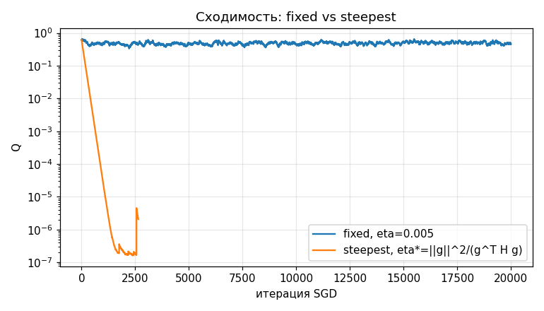
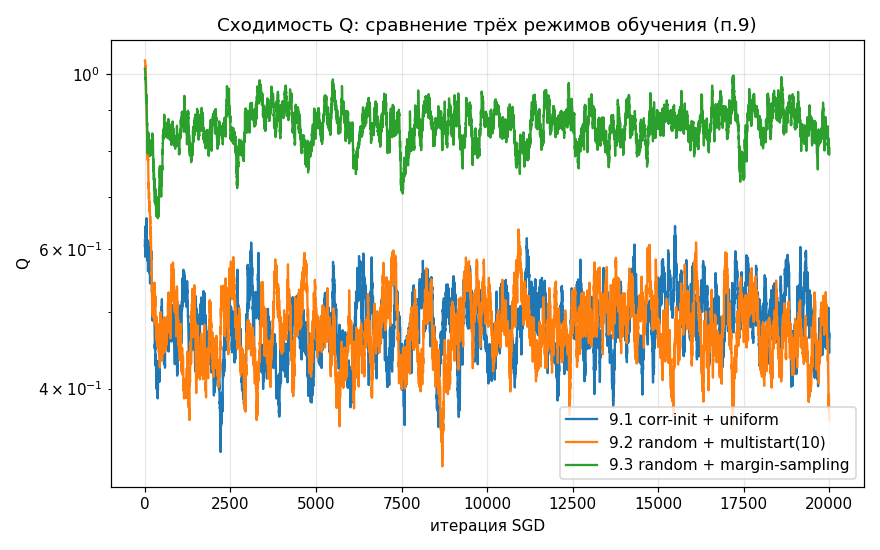
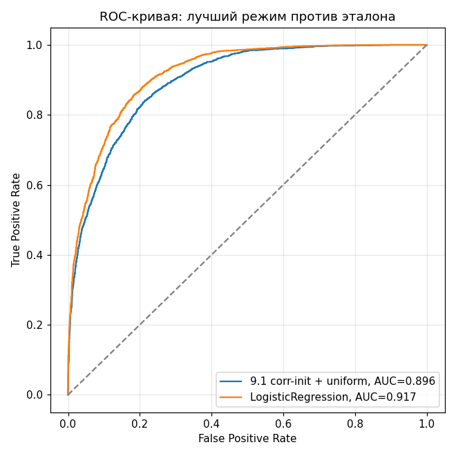
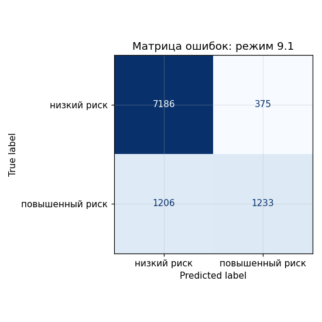

# ???????????? ?????? ?1. ???????? ?????????????

## ?????? ? ??????

?? ????? ???????????:

```sh
python -m pip install numpy pandas scikit-learn matplotlib
python students/kustarev-ap/lab1/source/run_experiment.py
```

??? ?????????? CSV ?? ????????????? ??????????? ?? ?????????? ?????? Kaggle, ??????????????? ? ??????????? ? `data/E-commerce_Customer_Segmentation_2026.csv`. ??? ??????? ??????? ????? ????????. ????????: https://www.kaggle.com/datasets/datascikhan/e-commerce-customer-segmentation-2026
?????? ??????: https://www.kaggle.com/api/v1/datasets/download/datascikhan/e-commerce-customer-segmentation-2026
??? ????????????? API ???????? ????? ?? ???????? ????????? ? ????????? CSV ?? ?????????? ????. ?????? ???????? ???????? URL ? ????????? ????.

50000 ????????; Very Low/Low ????????????? -1, Medium/High/Very High ? +1. ???????????? 12 ???????? ? 9 ?????????????? ?????????; ??????????? ?? ??????? ?????????.

## ????????

?????????????????? ????????? train/validation/test = 60/20/20, random_state=42. StandardScaler ? OneHotEncoder ????????? ?????? ?? train. ??? ???????????? ????, L2, ????????????? ? ??????? ?????????? validation. ??????????? ???????? ???? ?? ????????? Q. ???????? ????? ?????????? ?? validation ROC-AUC. ????? ???????? ?????? ?? ? ??????? ???????? DummyClassifier/LogisticRegression ??????????? ?? test. ROC ? ??????? ?????? ????????? ? ??? ?? ???????? ??????.

## ????????? ???

??? steepest momentum ???????? ?????????? ?? gamma: ?????????? w := w - eta*g. ??? fixed ??????????? gamma=0.9. ????? g ? ???????? ???????????? ?????? ???????? ??????? ???? L2 (bias ?? ??????????????), eta = (g?g)/(g?Hg). ??? ?????? ??????????? ????? -g ??? ???????? ??????? ? ??????????????, ? ?? ???? ????????? ???????. ??? L2=0 ??? ???????? ? ??????? 1. ?????? ??? ?????????? ??????? ?? ??????????? ??????? ???????? ?? validation.

????? ??????????? validation ROC-AUC: fixed 0.893323, steepest 0.825913. ??????? ?????????? ????? ????????? ?????????? ??? ? ??????? test-?????? ?????????.



## ????????? ???????

| ????? | Validation ROC-AUC |
|---|---:|
| 9.1 correlation + uniform | 0.893323 |
| 9.2 random + multistart(10) | 0.883830 |
| 9.3 random + margin | 0.885402 |

?????? ????? 9.1. ?? test: accuracy 0.8419, ROC-AUC 0.896132. LogisticRegression: accuracy 0.8541, ROC-AUC 0.916569; DummyClassifier: accuracy 0.7561, ROC-AUC 0.5. ?????? ? ???????? ?? AUC ? 0.020437. Margin sampling ? ???? ??????? ?? ???????? AUC; ??????????? ?? ????????? Q ?? ??????????? ?????? validation-???????.





?????? ????? ???????????????? ??????? ? ? results.txt. ??????? ????????? ??? ?? ???????? ??? ??? ???????????? ??????????.
